# TechPulse — Portal de Notícias de Tecnologia

Projeto de página inicial em **HTML5 semântico + CSS3 externo**, adaptado do layout de referência do portal TechPulse (notícias, reviews, dicas e tutoriais).

## Autor:
Alan dos Santos Paschoa - 108911

## 1. Estrutura do projeto

```
techpulse/
├── index.html    # Página inicial (HTML5 semântico)
├── style.css     # Folha de estilos externa
├── imagens/      # 10 fotos usadas nas matérias (JPG otimizado)
│   ├── chip-npu.jpg · byd-dolphin-mini.jpg · data-center.jpg · smartphones.jpg
│   ├── eletropostos.jpg · notebook-ia.jpg · iphones.jpg · wifi.jpg
│   └── windows.jpg · bmw-ix.jpg
└── README.md     # Este documento
```

Para visualizar, basta abrir o `index.html` no navegador (nenhuma instalação necessária).

## 2. Tecnologias e serviços utilizados

| Item | Uso no projeto | Justificativa |
|---|---|---|
| **HTML5** | Estrutura e semântica | Tags como `header`, `nav`, `main`, `section`, `article`, `aside` e `footer` descrevem o papel de cada bloco, melhorando acessibilidade e SEO |
| **CSS3 (arquivo externo)** | Estilização | Separa conteúdo de apresentação e permite reaproveitar estilos em outras páginas |
| **CSS Grid e Flexbox** | Layout | Grid para as colunas principais (conteúdo + barra lateral) e Flexbox para alinhamentos internos |
| **Variáveis CSS (`:root`)** | Paleta de cores | Trocar uma cor em um só lugar atualiza todo o portal |
| **Media queries** | Responsividade | Layout se adapta a tablets (≤ 900 px) e celulares (≤ 600 px) |
| **Imagens JPG otimizadas** | Fotos das matérias | Redimensionadas (máx. 1400 px) e comprimidas; `object-fit: cover` mantém o enquadramento e `loading="lazy"` adia o carregamento das que estão fora da tela |
| **Google Fonts (Open Sans)** | Tipografia | Fonte gratuita, muito legível em tela e com vários pesos |
| **Git/GitHub (sugerido)** | Versionamento e publicação | O GitHub Pages permite publicar o portal gratuitamente |

## 3. Cumprimento dos requisitos do projeto

### 3.1 Estrutura base e semântica
- `<!DOCTYPE html>`, `<html lang="pt-BR">`, `<head>` com `<meta charset>`, `<meta viewport>`, `<title>` e `<link rel="stylesheet" href="style.css">`.
- `<body>` organizado em `<header id="cabecalho">`, `<main>` e `<footer>`.
- `<nav>` usado no menu principal, nos portais do grupo e no rodapé; `<article>` usado em cada notícia, chamada e cartão.

### 3.2 Conteúdo e acessibilidade
- **`<h1>`:** manchete principal ("Nova geração de chips promete IA rodando direto no celular…"). Existe apenas um por página.
- **`<h2>`:** subtítulo do destaque e títulos das seções ("Últimas notícias", "Mais lidas", "Dicas e Tutoriais").
- **Parágrafo de apresentação** com `<strong>` (informação mais importante) e `<em>` (ênfase).
- **Lista:** `<ul>` "Tecnologias e serviços" com 3 itens (NPU, Comparador de celulares, Newsletter), além de `<ol>` em "Mais lidas".
- **Imagens com `alt`:** todas as 10 fotos (``) têm texto alternativo descritivo em português.
- **Link como botão:** `<a href="#" class="btn">Leia a matéria completa</a>`.
- Extras de acessibilidade: `lang`, `aria-label` nos `<nav>`, `aria-current="page"`, `<label for>` no formulário e `:focus-visible` nos botões.

### 3.3 CSS externo e Box Model
- **Seletor de tag:** `body`, `h1, h2, h3`, `p`, `a`, `ul, ol`, `img`.
- **Classe reutilizável:** `.btn` (com variações `.btn--contorno` e `.btn--bloco`), usada em 4 lugares do portal (Entrar, Leia a matéria completa, Veja mais e Quero receber).
- **ID exclusivo:** `#cabecalho`, aplicado apenas ao `<header>` principal.
- **Cores:** hexadecimal (`#1452C4`) e RGBA (`rgba(0, 0, 0, 0.75)`).
- **Tipografia:** família, tamanhos, pesos e `text-align`.
- **Box Model:** `padding`, `border`, `margin` e `box-sizing: border-box` (veja a seção 4.3).

## 4. Justificativas de design

### 4.1 Paleta de cores

| Cor | Hexadecimal | Uso | Justificativa |
|---|---|---|---|
| Azul TechPulse | `#1452C4` | Cabeçalho, links, botões, categorias | Azul transmite confiança e tecnologia; é a identidade do portal |
| Azul escuro | `#0B3A8F` | Rodapé, hover dos botões | Variação da cor principal que cria profundidade sem fugir da identidade |
| Azul claro | `#9DB8FF` | Parte "pulse" do logo e categorias sobre fundo escuro | Garante contraste legível sobre azul e preto |
| Preto azulado | `#0F111A` | Faixa superior | Separa o portal da marca "pulse.com" |
| Texto | `#111111` | Títulos e corpo | Alto contraste (acima de 15:1 sobre branco) |
| Texto suave | `#5B6070` | Resumos e datas | Cria hierarquia entre título e apoio sem perder legibilidade |
| Fundo claro | `#F3F4F8` | Seção de dicas, caixas e newsletter | Destaca blocos sem usar bordas pesadas |
| Borda | `#E1E4EC` | Divisores | Separação discreta entre itens |
| Véu RGBA | `rgba(0,0,0,0.75)` | Degradê sobre a imagem do destaque | Mantém o texto branco legível sobre qualquer imagem |

### 4.2 Tipografia
- **Família:** *Open Sans* (fallback: Arial, sans-serif). É humanista, neutra e muito legível em tela, e combina com a identidade jornalística do portal.
- **Hierarquia de tamanhos:** manchete 40 px · títulos de seção 22 px · títulos de notícia 22 px · chamadas 14–20 px · corpo 16 px · metadados 12 px.
- **Pesos:** 800 em manchetes e logo, 700 em categorias e botões, 600 em menus, 400 no texto corrido.
- **Entrelinha:** 1,5 no corpo para leitura confortável e 1,2 em títulos para ficarem compactos.
- **Alinhamento:** texto à esquerda, o padrão de leitura em português; logo e botões centralizados.
- **Categorias** em caixa alta com `letter-spacing`, para funcionarem como etiqueta e identificar o assunto antes do título.

### 4.3 Espaços (Box Model)

| Elemento | Padding | Border | Margin | Justificativa |
|---|---|---|---|---|
| `.container` | `0 16px` | — | `0 auto` | Centraliza o conteúdo (máx. 1120 px) e evita que encoste na borda em telas pequenas |
| `.btn` | `12px 24px` | `2px solid` | `8px 0 0` | Área de clique confortável (mínimo recomendado de 44 px de altura) |
| `.secao-titulo` | `0 0 10px` | `2px solid` embaixo | `0 0 24px` | Linha forte que marca o início de cada seção |
| `.noticia` | `20px 0` | `1px solid` embaixo | — | Ritmo vertical constante entre notícias |
| `.hero__texto` | `120px 28px 28px` | — | — | O espaço superior cria o degradê; o inferior e os laterais dão respiro ao texto |
| `.newsletter` | `20px` | `4px solid` no topo | — | Destaca a caixa como área de conversão |
| `.rapidas article` | `16px` | `1px solid` lateral | — | Divide a faixa em 4 colunas |

Um espaçamento múltiplo de 4 px (4, 8, 12, 16, 20, 24…) mantém a consistência visual.

### 4.4 Layout
- **Grade principal:** `2fr / 1fr` nos destaques e `1fr / 320px` no conteúdo (coluna de notícias + barra lateral), reproduzindo o design de referência.
- **Largura máxima:** 1120 px, que mantém linhas de texto com tamanho confortável.
- **Responsivo:** em ≤ 900 px as colunas se empilham; em ≤ 600 px tudo vira coluna única.

## 5. Sitemap visual

### 5.1 Diagrama

```mermaid
graph TD
    HOME["Página inicial<br/>TechPulse"]

    HOME --> NOT["Notícias"]
    HOME --> REV["Reviews"]
    HOME --> DIC["Dicas e Tutoriais"]
    HOME --> CEL["Celulares"]
    HOME --> IA["Inteligência Artificial"]
    HOME --> GAM["Games"]
    HOME --> COM["Computadores"]
    HOME --> CAR["Carros"]
    HOME --> OFE["Ofertas"]
    HOME --> DOW["Downloads"]
    HOME --> INS["Institucional"]

    NOT --> N1["Nuvem e Data Centers"]
    NOT --> N2["Segurança e Golpes"]
    NOT --> N3["WhatsApp e Redes sociais"]
    NOT --> N4["Android"]

    REV --> R1["Áudio"]
    REV --> R2["Smartphones"]
    REV --> R3["Notebooks"]

    DIC --> D1["iPhone"]
    DIC --> D2["Internet e Wi-Fi"]
    DIC --> D3["Windows"]
    DIC --> D4["Apps"]

    CAR --> C1["Mobilidade elétrica"]
    CAR --> C2["Preços e autonomia"]

    OFE --> O1["Black Friday"]
    INS --> I1["Quem somos"]
    INS --> I2["Anuncie"]
    INS --> I3["Privacidade"]
    INS --> I4["Fale conosco"]
```



### 5.2 Hierarquia em árvore

```
Página inicial (/)
│
├── 1. NOTÍCIAS ................ espaço de conteúdo jornalístico
│   ├── Nuvem e Data Centers
│   ├── Segurança e Golpes
│   ├── WhatsApp e Redes sociais
│   └── Android
│
├── 2. REVIEWS ................. análises e notas
│   ├── Áudio
│   ├── Smartphones
│   └── Notebooks
│
├── 3. DICAS E TUTORIAIS ....... conteúdo educativo (passo a passo)
│   ├── iPhone
│   ├── Internet e Wi-Fi
│   ├── Windows
│   └── Apps
│
├── 4. CARROS ..................  tecnologia automotiva
│   ├── Mobilidade elétrica
│   └── Preços e autonomia
│
├── Celulares · Inteligência Artificial · Games · Computadores   (editorias temáticas)
├── Ofertas (Black Friday) · Downloads                           (serviços)
└── Institucional (Quem somos · Anuncie · Privacidade · Fale conosco)
```

### 5.3 Hierarquia de conteúdo e taxonomia

**Hierarquia de conteúdo** (do mais geral ao mais específico):

1. **Nível 0, Portal:** TechPulse (página inicial).
2. **Nível 1, Espaço/Editoria:** Notícias, Reviews, Dicas e Tutoriais, Carros etc. São os itens do menu principal.
3. **Nível 2, Subcategoria:** Android, Áudio, Windows, Mobilidade elétrica etc. Aparecem como *etiquetas* acima de cada título (ex.: "NUVEM", "CELULARES").
4. **Nível 3, Conteúdo:** a matéria, o review ou o tutorial em si.

**Taxonomia** (como o conteúdo é classificado):
- **Por formato/tipo de conteúdo** (Notícias, Reviews, Dicas): responde "o que é isto?".
- **Por assunto/tema** (Celulares, IA, Games, Computadores, Carros): responde "sobre o que fala?".
- **Por intenção do leitor** (Ofertas, Downloads): responde "o que eu quero fazer?".
- **Etiquetas transversais:** uma matéria pode pertencer a uma editoria e a um assunto ao mesmo tempo. Ex.: "Notebook com IA vale a pena?" está em *Dicas e Tutoriais* (formato) e *Computadores* (tema), como indica o texto "Em Dicas e Tutoriais" ao lado da etiqueta.
- **Navegação:** o menu principal mostra o nível 1, a etiqueta de cada card mostra o nível 2 e o rodapé reorganiza os links por função (Editorias, Serviços, Institucional).

### 5.4 Correspondência entre sitemap e página

| Área do sitemap | Onde aparece em `index.html` |
|---|---|
| Menu de editorias | `<nav class="menu-principal">` no cabeçalho |
| Destaque / Notícias | `<article class="hero">` e `.destaques__lateral` |
| Últimas notícias | `<section class="ultimas">` |
| Reviews | Bloco "Reviews" na barra lateral |
| Dicas e Tutoriais | `<section class="dicas">` |
| Ofertas / Black Friday | Chamada rápida "Black Friday" |
| Institucional | Coluna "Institucional" do `<footer>` |

---
*Projeto acadêmico, 2026. Os textos e as marcas do layout são fictícios.*
